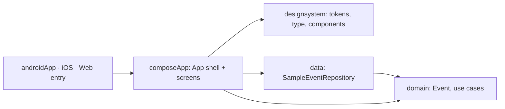

# Architecture

## Stack

- Kotlin Multiplatform with Compose Multiplatform: one shared codebase for Android, iOS and Web (Kotlin/Wasm).
- kotlinx-datetime for every date and time. Events are shown in `Europe/Lisbon`.
- Navigation Compose with `@Serializable` destinations (kotlinx-serialization).
- Koin for dependency injection, from shared code on every platform.
- Multiplatform `lifecycle` ViewModels, one per screen, exposing `StateFlow`.

## How it fits together

## Key decisions

- Clean architecture: `domain` has no Compose, platform or data dependency. Use cases (`GetUpcomingEvents`, `GetEvent`, `CountEventsThisWeek`) take an `EventRepository`, a `Clock` and a `TimeZone`.
- There's no backend yet. `SampleEventRepository` dates its events today and tomorrow from the clock, so they always look upcoming. Real data will come from a backend later.
- Poster colors are event data (ARGB `Long` in `PosterColors`), not design tokens, so `domain` stays free of Compose.
- Koin over Hilt: Hilt can't inject shared multiplatform code. There's one Koin module per layer:
  - `dataModule` in `data`: the sample events, the in-memory `OrderRepository`, and the `AccountRepository` and `PasswordHasher`, all singletons. The `KeyValueStore` behind the accounts comes from each platform, through `initKoin(platform)`.
  - `domainModule` in `composeApp/di`, holding the use cases (including `PlaceOrder`, `GetTicketGroups`, `CreateAccount`, `LogIn`, `ContinueWithGoogle` and `GetSession`) plus the `Clock` and `Europe/Lisbon` `TimeZone`. It sits there so `domain` stays free of DI code.
  - `presentationModule` in `composeApp/di`, holding the ViewModels
- Koin starts once per process through `initKoin(platform)`: `HomeoutApplication` on Android (SharedPreferences), `main()` on Web (in-memory, never read), and guarded in `MainViewController` on iOS (NSUserDefaults). Never start it from a composable or an activity.
- Accounts: `CreateAccount` and `LogIn` are domain rules over an `AccountRepository` port, and the signed-in email is the session. `StoredAccountRepository` keeps accounts as `account.<email>.name` and `.password`, and the session as `session.email`, in a `KeyValueStore`. It keeps no copy, so it always reads the store. Emails are trimmed and lowercased.
- Passwords: `Pbkdf2PasswordHasher` stores PBKDF2-HMAC-SHA256 as `<iterations>:<salt>:<hash>` in base64 (600,000 rounds, a 16-byte salt, off the main thread). `expect`/`actual` functions supply PBKDF2 and secure random bytes from `javax.crypto` (Android) and CommonCrypto (iOS), and throw on Web, which never hashes.
- Editions: `App(edition)` is `AppEdition.App` or `AppEdition.Web`. Web starts on Home, hides the header's account and the tab bar, and sends Buy tickets to `GetAppDestination`. It still registers Login, Signup, Buy and QR, each redirecting, because a restored URL fragment can name any screen.
- `App` is a shell: background, flower border and header stay fixed while a `NavHost` swaps screens beneath. `RootDestination` holds the Home and Tickets tabs and their bar, and Event, Buy and QR push over it. Each destination takes its ViewModel with `koinViewModel()`, scoped to its back-stack entry, so state survives going back and activity recreation.
- Pay hands its confirmation to the root entry's own `RootViewModel` (`koinViewModel(viewModelStoreOwner = rootEntry)`), then pops back to the root. Don't write to `NavBackStackEntry.savedStateHandle` for this: in navigation 2.10 that handle belongs to a separate internal ViewModel, not the Koin one.
- Orders are domain rules: `PlaceOrder` checks 1–8 and payment-iff-paid, and `GetTicketGroups` numbers and codes tickets per event, in agenda order.
- `EventViewModel` reads its id from `SavedStateHandle.toRoute<EventDestination>()`.
- Web binds browser history through the `onNavHostReady` hook in `wasmJsMain/main.kt`. Android system back comes from the `NavHost` itself.

## Gotchas

- AGP 9: shared modules use `com.android.kotlin.multiplatform.library`, and the Android app is its own module (`androidApp`).
- iOS can't be built on Windows. The target and entry exist and are built and tested on macOS.
- The Android `minSdk` is 26: `PBKDF2WithHmacSHA256` doesn't exist on API 24 and 25.
- Don't add cryptography-kotlin: on Wasm it pulls in `kotlinx-io`, whose import object calls `import.meta`, and every Karma test (and likely the browser bundle) fails with `Cannot use 'import.meta' outside a module`.
- Typed passwords stay in the ViewModel's memory, never in `SavedStateHandle` or `rememberTextFieldState`, which are saved to disk when the process dies.
- The iOS hashing and storage code can't be compiled on Windows. It is checked on macOS.
- Navigation pulls a newer `androidx.activity`, so the catalog pins it to the version navigation resolves.
- Prefer a plain `MutableStateFlow` that's updated directly for screen state. A `combine` plus `stateIn` left the Buy screen blank in Web UI tests: its value arrived on a browser tick the test's idle wait doesn't drive.
