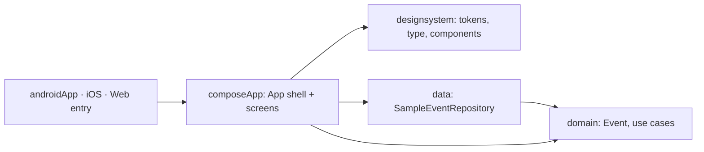

# Architecture

## Stack

- Kotlin Multiplatform with Compose Multiplatform: one shared codebase for Android, iOS and Web (Kotlin/Wasm).
- kotlinx-datetime for every date and time. Events are shown in `Europe/Lisbon`.
- Navigation Compose with `@Serializable` destinations (kotlinx-serialization).
- Coroutines: `StateFlow` state holders.

## How it fits together

## Key decisions

- Clean architecture: `domain` has no Compose, platform or data dependency. Use cases (`GetUpcomingEvents`, `GetEvent`, `CountEventsThisWeek`) take an `EventRepository`, a `Clock` and a `TimeZone`.
- There's no backend yet. `SampleEventRepository` dates its events today and tomorrow from the clock, so they always look upcoming. Real data will come from a backend later.
- Poster colors are event data (ARGB `Long` in `PosterColors`), not design tokens, so `domain` stays free of Compose.
- Wiring is manual: `App` builds the repository, use cases and `HomeStateHolder` with `remember`. There's no DI framework.
- `App` is a shell: background, flower border and header stay fixed while a `NavHost` swaps Home and the event page beneath. `HomeStateHolder` lives outside the `NavHost`, so the filter and search survive going back.
- Web binds browser history through the `onNavHostReady` hook in `wasmJsMain/main.kt`. Android system back comes from the `NavHost` itself.

## Gotchas

- AGP 9: shared modules use `com.android.kotlin.multiplatform.library`, and the Android app is its own module (`androidApp`).
- iOS can't be built on Windows. The target and entry exist and are built and tested on macOS.
- Navigation pulls a newer `androidx.activity`, so the catalog pins it to the version navigation resolves.
