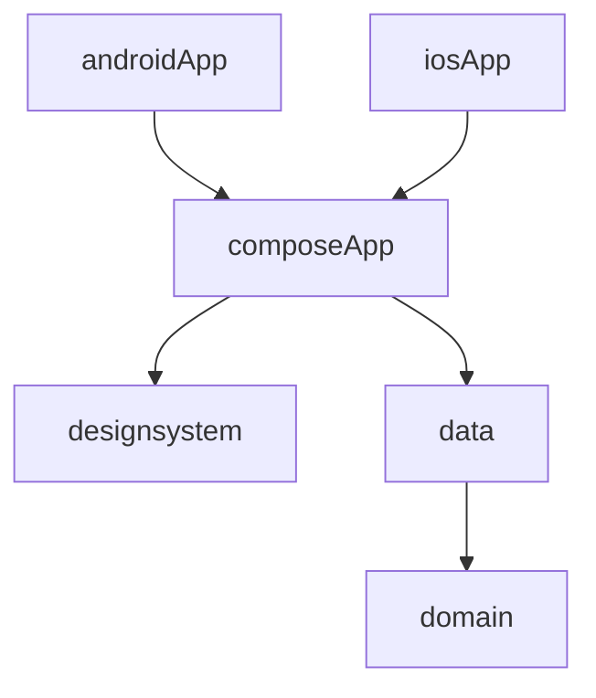

# Codebase Map

## Areas

- `domain`: the event model and use cases. Pure Kotlin.
- `data`: the local sample events (`SampleEventRepository`).
- `designsystem`: colors, type scale, theme, buttons, icons, the flower border, fonts and licenses. Its `Res` is internal, so composeApp reaches images only through designsystem components.
- `composeApp`: the app shell (`App`, `AppHeader`, `Destinations`), `home/` and `event/` screens, plus the iOS and Web entry points.
- `androidApp`: the Android entry point (`MainActivity`).
- `iosApp`: the Xcode project that hosts `MainViewController`.
- `aidd_docs/specs/`: one spec per feature. `aidd_docs/tasks/<yyyy_mm>/`: plans and phases.

## Entry points

- Android: `androidApp/.../MainActivity.kt`
- Web: `composeApp/src/wasmJsMain/kotlin/app/homeout/main.kt`
- iOS: `composeApp/src/iosMain/kotlin/app/homeout/MainViewController.kt`
