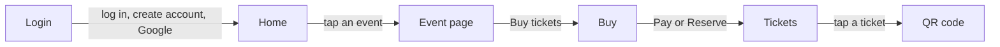

# Mobile

## Platform

- Cross-platform with Compose Multiplatform: Android (`androidApp`) and iOS (`iosApp`) share the domain, data and design system with Web, but not its UI.

## Navigation

## Native access

- None. No permissions are requested.

## State and storage

- Accounts and the session are stored on the device: SharedPreferences `homeout.accounts` on Android, NSUserDefaults on iOS. Passwords are salted PBKDF2 hashes. Android auto-backup is on, so they travel with the app's backup.
- Everything else is in memory: ViewModels (which survive activity recreation) and saveable Compose state. Orders are lost on close.

## Build and release

- Android (minSdk 26): `./gradlew :androidApp:installDebug`. Edge-to-edge is enabled after `super.onCreate`, so status-bar icons follow the theme.
- iOS: open `iosApp/iosApp.xcodeproj` in Xcode on macOS.
- Nothing is published to a store yet.
