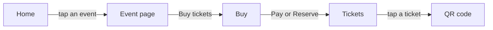

# Mobile

## Platform

- Cross-platform with Compose Multiplatform: Android (`androidApp`) and iOS (`iosApp`) share all logic and UI with Web.

## Navigation

## Native access

- None. No permissions are requested.

## State and storage

- In-memory only: ViewModels (which survive activity recreation) and saveable Compose state. Nothing is stored on the device.

## Build and release

- Android: `./gradlew :androidApp:installDebug`. Edge-to-edge is enabled after `super.onCreate`, so status-bar icons follow the theme.
- iOS: open `iosApp/iosApp.xcodeproj` in Xcode on macOS.
- Nothing is published to a store yet.
