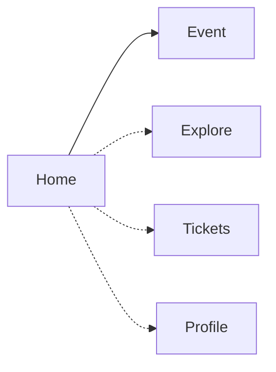

# Navigation

## Routing

- Navigation Compose. Destinations are `@Serializable` types in `composeApp/.../Destinations.kt`: `HomeDestination` and `EventDestination(id)`.
- The `NavHost` sits inside the `App` shell, below the fixed header. Its transitions are the design's push: 360 ms on `cubic-bezier(0.2, 0.8, 0.2, 1)`, the new page slides in from the right while Home moves 28% left and fades.
- Back returns to Home with `popBackStack(HomeDestination, inclusive = false)`. An unknown event id goes back Home.
- No protected routes: there are no accounts.

## Structure

