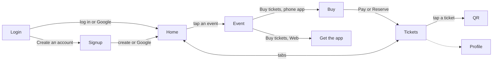

# Navigation

## Routing

- Navigation Compose. Destinations are `@Serializable` types in `composeApp/.../Destinations.kt`: `LoginDestination`, `SignupDestination`, `RootDestination` (the Home and Tickets tabs), `EventDestination(id)`, `BuyDestination(id)`, `QrDestination(eventId, index)` and, on Web, `GetAppDestination(id)`.
- The `NavHost` sits inside the `App` shell, below the fixed header. Its transitions are the design's push: 360 ms on `cubic-bezier(0.2, 0.8, 0.2, 1)`. The new page slides in from the right while the one behind moves 28% left and fades.
- Tabs aren't destinations. `RootViewModel` holds the selected tab, and a new tab pane fades up over 320 ms. Profile takes no taps.
- Back pops one entry, but never the root. Pay pops to `RootDestination` on the Tickets tab, so Buy and Event leave the stack. An unknown event id goes back.
- The phone app starts on Login, or on Root when `GetSession` finds someone signed in. Signing in (email, Create account or Google) navigates to Root and pops Login and Signup, so back from Home leaves the app. Signup's back, and system back, return to Login. Log in instead pops Signup after filling Login's email through Login's own ViewModel.
- Login and Signup sit before Root, so signing in slides them away. The header fades out over 360 ms on them and back in on Home, keeping its space.
- Web starts on Root and has no tabs. Buy tickets pushes `GetAppDestination`. A restored URL naming Buy goes to Get the app, and one naming Login, Signup or QR goes back to Home.

## Structure

