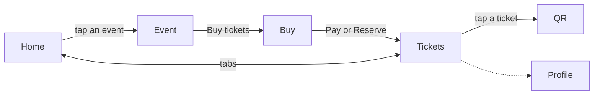

# Navigation

## Routing

- Navigation Compose. Destinations are `@Serializable` types in `composeApp/.../Destinations.kt`: `RootDestination` (the Home and Tickets tabs), `EventDestination(id)`, `BuyDestination(id)` and `QrDestination(eventId, index)`.
- The `NavHost` sits inside the `App` shell, below the fixed header. Its transitions are the design's push: 360 ms on `cubic-bezier(0.2, 0.8, 0.2, 1)`. The new page slides in from the right while the one behind moves 28% left and fades.
- Tabs aren't destinations. `RootViewModel` holds the selected tab, and a new tab pane fades up over 320 ms. Profile takes no taps.
- Back pops one entry, but never the root. Pay pops to `RootDestination` on the Tickets tab, so Buy and Event leave the stack. An unknown event id goes back.
- No protected routes: there are no accounts.

## Structure

